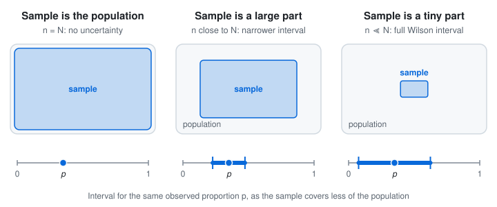

# Wilson Interval

[](https://github.com/erikfox/wilson-interval/actions/workflows/ci.yml?query=branch%3Amaster)
[](https://www.npmjs.com/package/wilson-interval)
[](https://www.npmjs.com/package/wilson-interval)
[](https://codecov.io/github/erikfox/wilson-interval)
[](LICENSE)

Calculates the **low bound**, **center** and **high bound** of a **[Wilson score interval](https://en.wikipedia.org/wiki/Binomial_proportion_confidence_interval#Wilson_score_interval)** for a binomial proportion, with optional **finite population correction** (Singleton's adjustment) and **continuity correction**.

The low bound is a popular way to rank items by their share of positive votes, as described in Evan Miller's **[How Not To Sort By Average Rating](https://www.evanmiller.org/how-not-to-sort-by-average-rating.html)** and used for Reddit's "best" comment sort.

No dependencies, ES module only, TypeScript definitions included. Requires Node.js 22 or later.

**[Try it in your browser →](https://erikfox.github.io/wilson-interval/)**

## Install

```sh
npm install wilson-interval
```

## Usage

```js
import wilson from 'wilson-interval';

console.log(wilson(5, 100));
```

```text
{
  high: 0.11175046929755608,
  center: 0.06664707421899263,
  low: 0.02154367914042918
}
```

### `wilson(observed, sample[, options])`

- `observed`: required. Count of positive outcomes, a whole number from `0` to `sample`.
- `sample`: required. Sample size, a positive whole number.
- `options`: optional object.

| Option | Default | Description |
|---|---|---|
| `confidence` | `0.95` | Confidence level, a number strictly between 0 and 1. |
| `population` | none | Size of the finite population the sample was drawn from, a whole number of at least `sample`. Narrows the interval (see [Finite population correction](#finite-population-correction)). |
| `continuityCorrection` | `false` | Widens the bounds with a continuity correction (see [Continuity correction](#continuity-correction)). |

Returns `{ high, center, low }`, with `0 <= low <= center <= high <= 1`. `center` is the center of the Wilson interval, which is pulled toward 0.5 compared with the observed proportion `observed / sample`.

Throws an `Error` if an argument is out of range or not a whole number, if an option is misspelled or has the wrong type, or if it's called with the v5 positional arguments (see [Migrating from v5](#migrating-from-v5)).

### Options example

```js
import wilson from 'wilson-interval';

console.log(wilson(5, 100, { confidence: 0.99 }));
console.log(wilson(5, 100, { population: 227 }));
console.log(wilson(5, 100, { continuityCorrection: true }));
```

```text
{
  high: 0.13915030303862663,
  center: 0.07799930953114226,
  low: 0.016848316023657876
}
{
  high: 0.09258652905391976,
  center: 0.05950886404522964,
  low: 0.02643119903653953
}
{
  high: 0.11829946393542573,
  center: 0.06664707421899263,
  low: 0.018552563709170015
}
```

### TypeScript

Types ship with the package. `WilsonOptions` and `WilsonInterval` are exported:

```ts
import wilson, { type WilsonOptions, type WilsonInterval } from 'wilson-interval';

const options: WilsonOptions = { confidence: 0.9 };
const result: WilsonInterval = wilson(5, 100, options);
```

## Use cases

### Ranking by the low bound

Sorting by the low bound puts more weight on confidence than on the raw ratio. An item with one vote, all positive, won't outrank an item with 90 positive votes out of 100 until there is enough data to be confident its ratio really is that high.

```js
import wilson from 'wilson-interval';

const items = [
  { name: 'A', positive: 1, total: 1 },
  { name: 'B', positive: 90, total: 100 },
  { name: 'C', positive: 8, total: 10 },
];

const ranked = items
  .map((item) => ({ ...item, score: wilson(item.positive, item.total).low }))
  .sort((a, b) => b.score - a.score);

console.log(ranked.map((item) => `${item.name} ${item.score.toFixed(3)}`));
```

```text
[ 'B 0.826', 'C 0.490', 'A 0.207' ]
```

### Finite population correction

Pass `population` when your sample is a significant part of a known, finite population. Observing more of the population leaves less uncertainty, so the interval narrows.

<picture>
  <source media="(prefers-color-scheme: dark)" srcset="assets/finite-population-dark.svg">
  
</picture>

> Descriptive statistics summarises the sample as if it were the entire population (left), whereas inferential statistics assumes the sample is a tiny subset of the population (right). If the sample is a large part of the population the confidence interval on observations is reduced (middle).<sup>[1]</sup>

**Use it when:**

1. Your sample is a significant portion of the population.
2. You have an imperfect original sample from which you can only verify a subsample. The original sample can serve as the "population" to produce a verification interval to combine with the first.<sup>[2]</sup>

**How it's calculated:** the observed proportion `p = observed / sample` is unchanged. The sample size used for the interval is divided by ν², where ν = √((N − n) / (N − 1)) is the finite population correction.<sup>[1]</sup> If `sample` equals `population`, the whole population was observed and the interval collapses to `p`:

```js
import wilson from 'wilson-interval';

console.log(wilson(5, 100, { population: 100 }));
```

```text
{ high: 0.05, center: 0.05, low: 0.05 }
```

> **Note:** The worked example in *Coping with imperfect data*<sup>[2]</sup> (5 of 100 from a population of 227, giving 0.0240–0.1011) divides n by ν instead of ν². This module follows the ν² adjustment described in [1], which matches the variance of sampling without replacement, so it returns 0.0264–0.0926 for that example.

### Continuity correction

The Wilson interval approximates a discrete distribution with a continuous one. The continuity correction compensates for this by computing the lower bound from `p − 1/(2n)` and the upper bound from `p + 1/(2n)` (clamped to [0, 1]), which makes the interval more conservative.<sup>[3][4]</sup> It is the interval R's `prop.test(x, n, correct = TRUE)` reports, except when `observed` is exactly half of `sample` (see [Accuracy](#accuracy)).

- `center` is not changed by the correction.
- With `population`, the bounds use the population-adjusted sample size, and the `1/(2n)` shift uses the original sample size.<sup>[3]</sup> If `sample` equals `population`, the interval still collapses to `p`.

## Migrating from v5

v6 replaces the positional `population` and `confidence` arguments with an options object:

```js
// v5
wilson(5, 100, 227, 0.9);
wilson(5, 100, null, 0.9);

// v6
wilson(5, 100, { population: 227, confidence: 0.9 });
wilson(5, 100, { confidence: 0.9 });
```

Calling v6 with the v5 arguments throws instead of silently returning a different result:

```text
wilson() takes an options object as its third argument since v6. Replace wilson(observed, sample, population, confidence) with wilson(observed, sample, { population, confidence }).
```

Other changes in v6 (see the [changelog](CHANGELOG.md) for every release):

- Node.js 22 or later is required.
- New `continuityCorrection` option.
- Misspelled options, such as `{ confidnce: 0.9 }`, now throw.
- TypeScript definitions are included.
- Results with `population` changed in v5.1.1 to fix the finite population correction. See the [v5.1.1 release notes](https://github.com/erikfox/wilson-interval/releases/tag/v5.1.1).

## Also exported

`normalQuantile(p)` returns the quantile (inverse CDF) of the standard normal distribution, which `wilson()` uses for its critical value. It uses Peter J. Acklam's rational approximation, which has a relative error below 1.15 × 10⁻⁹.<sup>[5]</sup>

```js
import { normalQuantile } from 'wilson-interval';

console.log(normalQuantile(0.975));
```

```text
1.959963986120195
```

## Accuracy

- **Independent reference values.** Expected test values are not copied from this module's output. [`scripts/reference.py`](scripts/reference.py) computes them with Python's standard library: it solves the Wilson quadratic directly, takes the critical value from `statistics.NormalDist`, and checks the continuity correction against Newcombe's closed form and the worked examples in his Table I.<sup>[4]</sup> The [`reference` CI job](.github/workflows/ci.yml) fails if [`scripts/reference.json`](scripts/reference.json) is out of sync with the script.
- **Agrees with R.** Without `population`, the continuity-corrected interval matches R's [`prop.test(x, n, correct = TRUE)`](https://stat.ethz.ch/R-manual/R-devel/library/stats/html/prop.test.html) to about nine significant digits, the accuracy of `normalQuantile`. The one difference: `prop.test` only applies the correction when it doesn't exceed the distance from its null proportion (0.5 by default), so when `observed` is exactly half of `sample` it returns the uncorrected interval and this module doesn't.
- **100% coverage, enforced.** The [`coverage` CI job](.github/workflows/ci.yml) runs `npm run test:cc`, which fails if line, branch or function coverage drops below 100%.
- **Published with provenance.** Releases are published to npm from a [GitHub Actions workflow](.github/workflows/npm-publish.yml) using trusted publishing, so each version since 5.1.1 carries a [provenance attestation](https://docs.npmjs.com/generating-provenance-statements) linking it to the commit and workflow run that built it.

## Sources

<sup>[1]</sup> [Wallis, Sean 2012. *Inferential Statistics — and other animals*. London: Survey of English Usage, UCL.](https://corplingstats.wordpress.com/2012/04/30/inferential-statistics/)

<sup>[2]</sup> [Wallis, Sean 2014. *Coping with imperfect data*. London: Survey of English Usage, UCL.](https://corplingstats.wordpress.com/2014/04/10/imperfect-data/)

<sup>[3]</sup> [Wallis, Sean 2019. *Correcting for continuity*. London: Survey of English Usage, UCL.](https://corplingstats.wordpress.com/2019/04/27/correcting-for-continuity/)

<sup>[4]</sup> [Newcombe, Robert G. 1998. *Two-sided confidence intervals for the single proportion: comparison of seven methods*. Statistics in Medicine 17(8): 857–872.](https://doi.org/10.1002/(SICI)1097-0258(19980430)17:8%3C857::AID-SIM777%3E3.0.CO;2-E)

<sup>[5]</sup> Acklam, Peter J. Rational approximation of the normal quantile function, originally published at `home.online.no/~pjacklam/notes/invnorm/`, which is no longer online. The algorithm, coefficients and error bound are reproduced in [*Acklam's Algorithm for the Inverse Normal CDF*](https://stackedboxes.org/2017/05/01/acklams-normal-quantile-function/), StackedBoxes.org, 2017.

___
*Special thanks to [Sean Wallis](https://profiles.ucl.ac.uk/21175-sean-wallis), Principal Research Fellow and Deputy Director of the Survey of English Usage, UCL, for his help transcribing equations, and for the blog posts that inspired many of this module's features.*
